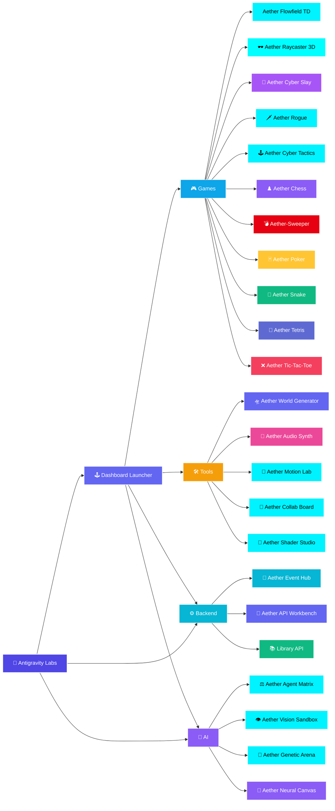

# 🛸 Antigravity Labs

Repositório de projetos pessoais voltados para aprendizado, experimentação e desenvolvimento de software utilizando o antigravity.

Aqui ficam jogos, ferramentas, APIs, automações e qualquer outra ideia que pareça interessante de construir.

Este repositório foi estruturado para organizar os projetos por escopo de desenvolvimento, facilitando o gerenciamento do código e a modularidade de novas soluções.

---

## 📂 Estrutura do Repositório

```text
antigravity-labs/
├── index.html   # Painel Dashboard Launcher (Central)
├── server.py    # Servidor Central Unificado em Python
├── ai/          # Projetos e modelos envolvendo Inteligência Artificial
│   ├── aether_agent_matrix/ # Aether Agent Matrix - Arena de debates multi-agente com LLMs locais via WebGPU e CPU Worker (WebLLM, Transformers.js)
│   ├── aether_genetic_arena/ # Aether Genetic Arena - Laboratório de Neuroevolução & NEAT (Canvas 2D, Spatial Grid)
│   ├── aether_vision/ # Aether Vision Sandbox - Laboratório de Visão Computacional & Gestos em Tempo Real (MediaPipe, Web Audio API)
│   └── neural_canvas/ # Aether Neural Canvas - Reconhecimento de desenhos em tempo real (TensorFlow.js)
├── backend/     # APIs, microsserviços e utilitários de servidor
│   ├── aether_api_workbench/ # Aether API Workbench & Mock Server (FastAPI, SQLite, REST/WS Proxy, JSON Schema Mocks & Latency Analytics)
│   ├── aether_event_hub/ # Aether Event Hub & Task Queue - Fila de eventos e agendamento async (FastAPI, SQLite WAL, WebSockets)
│   └── library_api/ # API de Biblioteca (FastAPI, SQLite, SQLAlchemy)
├── games/       # Jogos interativos e experiências visuais
│   ├── aether_cyber_slay/ # Aether Cyber Slay - Roguelike deckbuilder cyberpunk em turnos
│   ├── aether_cyber_tactics/ # Aether Cyber Tactics - Jogo tático 2.5D isométrico cyberpunk
│   ├── aether_flowfield_td/ # Aether Flowfield TD - Tower Defense cyberpunk de enxames massivos com Flow Field Dijkstra, TypedArrays e Web Audio
│   ├── aether_raycaster/ # Aether Raycaster 3D - Cyberpunk FPS pseudo-3D com raycasting DDA e áudio procedural synthwave
│   ├── aether_rogue/ # Aether Rogue - Roguelike 2D procedural
│   ├── chess/   # Aether Chess - Xadrez Premium com IA local
│   ├── minesweeper/ # Aether-Sweeper - Campo Minado 8-Bit Retro Arcade
│   ├── poker/   # Aether Poker - Texas Hold'em com bots inteligentes e side pots
│   ├── snake/   # Aether Snake - Cobrinha com IA Autopilot (BFS + Cauda) e modo Manual
│   ├── tetris/  # Aether Tetris - Tetris Premium inspirado no design da Linear.app
│   └── tictactoe/ # Aether Tic-Tac-Toe - Jogo da Velha com IA Minimax
└── tools/       # Ferramentas, scripts de automação e utilitários
    ├── aether_collab_board/ # Aether Collab Board - Canvas infinito para diagramação e quadros interativos (Mermaid.js, WebSockets)
    ├── aether_motion_lab/ # Aether Motion Lab - Laboratório de arte gerativa e partículas em tempo real (TypedArrays Engine)
    ├── aether_shader_studio/ # Aether Shader Studio - Live WebGL2 Shader Editor (GLSL 300 es, Monaco, Audio FFT, Export)
    ├── aether_synth/ # Aether Audio Synth - Estúdio de Síntese Modular (FM/AM), Gerador 8-Bit sfxr, Tracker, FX & Performance
    └── world_generation/ # Aether World Generator - Gerador procedural de mundos 2D e 3D (Three.js)
```

Abaixo está a visualização geral do repositório para novos projetos:



---

## 🎮 Projetos Disponíveis

### Games (Jogos)

| Projeto | Caminho | Status | Descrição | Tecnologias |
| :--- | :--- | :--- | :--- | :--- |
| **Aether Flowfield TD** | [games/aether_flowfield_td](./games/aether_flowfield_td) | `Concluído` | Tower Defense cyberpunk sem caminhos fixos com enxames massivos (10.000+ partículas a 60 FPS), pathfinding por Flow Field Dijkstra com Dynamic Breach Mode, Spatial Hash Grid e síntese Web Audio API. | HTML5, CSS3, JS, Web Audio API, Canvas 2D, Python |
| **Aether Raycaster 3D 🕶️** | [games/aether_raycaster](./games/aether_raycaster) | `Concluído` | Dungeon crawler pseudo-3D cyberpunk em primeira pessoa com raycasting DDA em Canvas 2D puro, mapas procedurais, portas deslizantes, drones com IA de linha de visão, áudio synthwave procedural e placar. | HTML5, CSS3, JS, Web Audio API, Python |
| **Aether Cyber Slay 🎴** | [games/aether_cyber_slay](./games/aether_cyber_slay) | `Concluído` | Roguelike deckbuilder cyberpunk em turnos com gestão de RAM e Superaquecimento, mercado negro e combate contra Apex Neural Core. | HTML5, CSS3, JS, Web Audio API, Python |
| **Aether Rogue 🗡️** | [games/aether_rogue](./games/aether_rogue) | `Concluído` | Roguelike dungeon crawler 2D em turnos com geração procedual híbrida (BSP + Cavernas), raycasting FOV 360° com névoa de guerra, IA A*, habilidades Cyberware e áudio sintetizado offline. | HTML5, CSS3, JS, Python |
| **Aether Cyber Tactics 🕹️** | [games/aether_cyber_tactics](./games/aether_cyber_tactics) | `Concluído` | Jogo tático 2.5D isométrico cyberpunk em turnos com esquadrão, elevação de terreno, ataques telegrafados e campanhas procedurais. | HTML5, CSS3, JS |
| **Aether Chess ♟️** | [games/chess](./games/chess) | `Concluído` | Xadrez premium contra IA minimax local, glassmorphism, áudio sintetizado offline e suporte a temas. | HTML5, CSS3, JS, Python |
| **Aether-Sweeper 💣** | [games/minesweeper](./games/minesweeper) | `Concluído` | Campo Minado com estética 8-bit retro arcade, primeiro clique seguro, chording, rumbles de explosão, confetes e som sintetizado offline. | HTML5, CSS3, JS, Python |
| **Aether Tetris 🧱** | [games/tetris](./games/tetris) | `Concluído` | Jogo de Tetris premium inspirado no design da Linear.app. Conta com 3 modos (Clássico, Contrarrelógio e Zen), seleção de níveis e áudio chiptune sintetizado offline. | HTML5, CSS3, JS, Python |
| **Aether Poker 🃏** | [games/poker](./games/poker) | `Concluído` | Jogo de Texas Hold'em premium com bots de perfis psicológicos (shark, fish, caller), side pots robustos e áudio sintetizado. | HTML5, CSS3, JS, Python |
| **Aether Snake 🐍** | [games/snake](./games/snake) | `Concluído` | Jogo da cobrinha com IA de busca de caminho (BFS + segurança e desvio de cauda) ou manual. | HTML5, CSS3, JS, Python |
| **Aether Tic-Tac-Toe ❌** | [games/tictactoe](./games/tictactoe) | `Concluído` | Jogo da velha com IA Minimax e Poda Alpha-Beta, modo PvP local, simulação e áudio sintetizado offline. | HTML5, CSS3, JS, Python |

> Para detalhes completos sobre os jogos, consulte suas respectivas documentações.

### AI (Inteligência Artificial)

| Projeto | Caminho | Status | Descrição | Tecnologias |
| :--- | :--- | :--- | :--- | :--- |
| **Aether Agent Matrix ⚖️** | [ai/aether_agent_matrix](./ai/aether_agent_matrix) | `Concluído` | Laboratório de inteligência artificial multi-agente e debates locais com LLMs no navegador via WebGPU e CPU Worker. Inclui orquestrador FSM em turnos, telemetria ao vivo, intervenção da audiência, veredito do juiz e exportação em Markdown e JSON. | HTML5, CSS3, JS, WebGPU, WebLLM, Transformers.js |
| **Aether Vision Sandbox 👁️** | [ai/aether_vision](./ai/aether_vision) | `Concluído` | Laboratório de visão computacional e gestos em tempo real com MediaPipe Hands, sintetizador de áudio espacial Theremin, modo Arcade Fruit Cutter e depurador de landmarks. | HTML5, CSS3, JS, MediaPipe, Web Audio API, Canvas 2D |
| **Aether Genetic Arena 🧬** | [ai/aether_genetic_arena](./ai/aether_genetic_arena) | `Concluído` | Laboratório 2D de Neuroevolução e NEAT com topologia dinâmica, física determinística, visão por raycasting, 3 cenários (Coleta, Labirinto, Predador-Presa), HUD neural em tempo real e Modo Deus interativo. | HTML5, CSS3, JS, Web Audio API, Canvas 2D |
| **Aether Neural Canvas 🎨** | [ai/neural_canvas](./ai/neural_canvas) | `Concluído` | Tela de desenho com IA local que classifica traços em tempo real via rede neural (DoodleNet), com modos Sandbox e Time Attack e sons sintetizados. | HTML5, CSS3, JS, TensorFlow.js, Python |

### Backend (APIs, Fila de Eventos e Microsserviços)

| Projeto | Caminho | Status | Descrição | Tecnologias |
| :--- | :--- | :--- | :--- | :--- |
| **Aether Event Hub 📡** | [backend/aether_event_hub](./backend/aether_event_hub) | `Concluído` | Sistema leve de agendamento de tarefas e fila de eventos distribuídos em background com monitoramento visual em tempo real via WebSockets, SQLite WAL e FastAPI. | Python, FastAPI, aiosqlite, WebSockets, HTML5, CSS3, JS |
| **Aether API Workbench 🔌** | [backend/aether_api_workbench](./backend/aether_api_workbench) | `Concluído` | Suíte completa de testes HTTP/REST, SSE e WebSocket em tempo real, gerador dinâmico de Mock Server com JSON Schema e análise gráfica de latência RTT. | Python, FastAPI, SQLite, HTML5, CSS3, JS |
| **Library API 📚** | [backend/library_api](./backend/library_api) | `Concluído` | API RESTful para gerenciamento de biblioteca (catálogo de livros, controle de leitores, autenticação JWT e gestão atômica de empréstimos/devoluções). | Python, FastAPI, SQLite, SQLAlchemy, PyJWT, Pytest |

### Tools (Ferramentas)

| Projeto | Caminho | Status | Descrição | Tecnologias |
| :--- | :--- | :--- | :--- | :--- |
| **Aether Audio Synth 🎹** | [tools/aether_synth](./tools/aether_synth) | `Concluído` | Estúdio de síntese de áudio retro em Web Audio API: Síntese Modular Dual (FM/AM), Gerador SFX 8-Bit (sfxr), Sequenciador 16 passos, Tracker / Arranjador de Músicas, Efeitos (Stereo Delay & Space Reverb), Mixer 5 faixas (Mute/Solo), Teclado Virtual QWERTY/MIDI, Osciloscópio & Espectrograma FFT CRT e exportação WAV/JSON. | HTML5, CSS3, JS, Web Audio API, Web MIDI API, Canvas |
| **Aether Motion Lab 🌌** | [tools/aether_motion_lab](./tools/aether_motion_lab) | `Concluído` | Laboratório de arte gerativa e partículas em tempo real com campos de vetores, atratores caóticos e interações físicas táteis. | HTML5, CSS3, JS, Canvas 2D |
| **Aether Collab Board 📐** | [tools/aether_collab_board](./tools/aether_collab_board) | `Concluído` | Canvas infinito para diagramação de arquitetura de software e quadros interativos com Mermaid.js, notas adesivas e modo apresentação. | HTML5, CSS3, JS, WebSockets, Python |
| **Aether Shader Studio 🔮** | [tools/aether_shader_studio](./tools/aether_shader_studio) | `Concluído` | Live WebGL2 shader editor inspirado no Shadertoy com Monaco Editor, reatividade a áudio em tempo real, biblioteca de presets e exportação em vídeo WebM e GIF em loop. | HTML5, CSS3, JS, WebGL2, GLSL, Web Audio API, Monaco Editor |
| **Aether World Generator 🛸** | [tools/world_generation](./tools/world_generation) | `Concluído` | Gerador procedural de mundos 2D e 3D (Three.js) com relevo, rios, reinos, estradas (A*), recursos, simulação histórica interativa (logs clicáveis, timeline, partículas 3D) e exportação completa em JSON. | HTML5, CSS3, JS, Three.js, Python |

---

## 🚀 Como Executar

O repositório utiliza um **Servidor Central Unificado** em Python para servir todos os projetos e um Painel Dashboard Launcher na raiz. O Dashboard Launcher oferece navegação dinâmica e categorizada entre **Games (Jogos)**, **Tools (Ferramentas)**, **AI (Inteligência Artificial)** e **Backend**.

### Inicializando o Servidor Central
Execute a partir do diretório raiz:

```bash
python server.py
```

Ou para o **Aether Event Hub & Task Queue**:
```bash
uv run uvicorn backend.aether_event_hub.main:app --reload --port 8000
```

Acesse no navegador:
*   **Painel Dashboard Launcher (Central)**: [http://localhost:8000/](http://localhost:8000/) — Interface unificada com categorias:
    *   **Jogos (Games)**: Aether Flowfield TD, Aether Raycaster 3D, Aether Cyber Slay, Aether Cyber Tactics, Aether Rogue, Aether Chess, Aether-Sweeper, Aether Tetris, Aether Snake, Aether Tic-Tac-Toe e Aether Poker.
    *   **Ferramentas (Tools)**: Aether World Generator, Aether Audio Synth, Aether Motion Lab, Aether Collab Board e Aether Shader Studio.
    *   **Inteligência Artificial (AI)**: Aether Agent Matrix, Aether Vision Sandbox, Aether Genetic Arena e Aether Neural Canvas.
    *   **Backend**: Aether Event Hub & Task Queue e Aether API Workbench & Mock Server.

---

## ⚙️ Tecnologias

O repositório é agnóstico de stack, utilizando a tecnologia mais apropriada para cada caso:

*   **Frontend:** HTML5, CSS3 Vanilla, JavaScript Moderno (ES6+)
*   **Backend:** Python (FastAPI, aiosqlite, SQLAlchemy, http.server), SQLite WAL, WebSockets
*   **IA/Algoritmos:** Algoritmos de busca (Minimax, Alpha-Beta, A*, BFS), heurísticas posicionais e redes neurais convolucionais
*   **Integrações:** Web Audio API, Canvas 2D/3D (Three.js)

---

## 📄 Licença

Este projeto está sob a licença MIT. Veja [LICENSE](./LICENSE) para mais detalhes.
