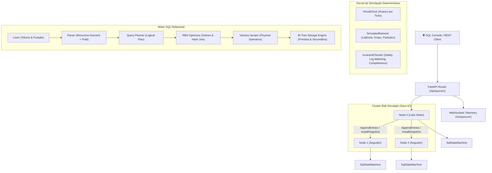

# 🗳️ Aether QuorumDB

**Aether QuorumDB** é um banco de dados relacional SQL distribuído de alto desempenho e fins educacionais construído artesanalmente do zero, combinando o algoritmo de consenso distribuído **Raft** com uma engine de banco de dados relacional alimentada por índices **B+Tree** em memória.

O projeto opera sobre um **kernel de simulação determinística**, permitindo reproduzir qualquer cenário de partição de rede, concorrência, perda de pacotes e crash de nós a partir de uma semente (*seed*), além de oferecer telemetria via WebSockets e um dashboard interativo para exploração em tempo real.

---

## 🏛️ Arquitetura do Sistema



---

## 🚀 Principais Funcionalidades

### 1. Núcleo de Consenso Raft (Sans-IO)
- **Eleição de Líder:** Eleição com timeouts randomizados por nó, troca de papéis (*Follower*, *Candidate*, *Leader*) e garantia do invariante *Election Safety* (no máximo 1 líder por termo).
- **Replicação de Log:** Replicação consistente de comandos, verificação de logs anteriores (`prev_log_index`/`prev_log_term`), aceleração na resolução de conflitos (`conflict_index`) e avanço de commit por maioria (§5.4.2).
- **Leituras Linearizáveis (ReadIndex):** Leituras consistentes executadas na máquina de estados local sem poluir o log, confirmando liderança ativa via quorum de heartbeats (§8).
- **Snapshots & Compactação:** Snapshotting da base de dados e envio de `InstallSnapshot` RPC (§7) para nós atrasados ou recém-recuperados.
- **Deduplicação de Requisições:** Sessões de clientes com `client_id` e `sequence_num` para idempotência sob retentativas de rede.

### 2. Motor SQL & Índices B+Tree
- **Gramática Completa:** Suporte a DDL (`CREATE TABLE`, `CREATE [UNIQUE] INDEX`, `DROP TABLE`), DML (`INSERT`, `UPDATE`, `DELETE`) e consultas (`SELECT`).
- **Pratt Parser de Expressões:** Operadores aritméticos, comparações, lógica booleana com precedência estrita (`AND`, `OR`, `NOT`), `IS [NOT] NULL`, `BETWEEN ... AND ...` e `IN (...)`.
- **Índices B+Tree Artesanais:** Implementação balanceada em memória com nós folha duplamente encadeados para range scans em $O(\log N + K)$, busca pontual em $O(\log N)$, suporte a chave primária e índices secundários únicos e não-únicos.
- **Otimizador Rule-Based (RBO):** Seleção automática de `IndexScan` para predicados em colunas indexadas, seleção de `HashJoin` para equi-joins e visualização da árvore física via `EXPLAIN`.
- **Agregações & Funções:** `COUNT(*)`, `SUM()`, `AVG()`, `MIN()`, `MAX()`, cláusula `GROUP BY`, filtro `HAVING`, `ORDER BY`, `LIMIT` e `OFFSET`.

### 3. Simulação Determinística & Injeção de Falhas
- **VirtualClock:** Relógio puramente lógico que avança por *ticks*, eliminando qualquer dependência de timing de CPU ou concorrência não determinística.
- **SimulatedNetwork:** Fila de prioridades com simulação de latência mínima/máxima, reordenação de pacotes, perda probabilística, duplicação e partições de rede arbitrárias.
- **Verificador de Invariantes:** Checagem contínua dos invariantes fundamentais do Raft:
  - *Election Safety*: No máximo 1 líder por termo.
  - *Log Matching*: Logs com mesmo índice e termo possuem prefixo idêntico.
  - *Leader Completeness*: Entradas commitadas estão presentes nos líderes de termos posteriores.
  - *State Machine Safety*: Máquinas de estados de todos os nós aplicam comandos idênticos na mesma ordem.

---

## 📂 Estrutura de Diretórios

```text
systems/aether_quorum_db/
├── api/                     # Camada HTTP e WebSockets
│   ├── router.py            # Endpoints REST e WebSocket
│   ├── schemas.py           # Modelos Pydantic de entrada e saída
│   └── ws.py                # Gerenciador de conexões WebSocket
├── raft/                    # Núcleo de Consenso Raft (Sans-IO)
│   ├── events.py            # Eventos observáveis (RoleChanged, EntryCommitted, EntryApplied)
│   ├── log.py               # Log Raft com suporte a compactação
│   ├── messages.py          # RPCs RequestVote, AppendEntries, InstallSnapshot
│   ├── node.py              # Máquina de estados RaftNode
│   └── persistent_state.py  # Estado durável (sobrevive a crashes)
├── replication/             # Máquinas de Estados
│   ├── state_machine.py     # Protocolo StateMachine e KVStateMachine
│   └── sql_state_machine.py # SqlStateMachine com detecção de não-determinismo
├── simulation/              # Kernel de Simulação Determinística
│   ├── clock.py             # VirtualClock
│   ├── cluster.py           # Coordenador de nós, rede e persistência
│   ├── faults.py            # Cenários de injeção de falhas (chaos engineering)
│   ├── invariants.py        # Validadores matemáticos de segurança
│   └── network.py           # Rede simulada não confiável
├── sql/                     # Motor SQL Relacional
│   ├── ast.py               # Definições de nós da árvore sintática
│   ├── btree.py             # Implementação artesanal da B+Tree
│   ├── catalog.py           # Catálogo de esquemas, colunas e índices
│   ├── database.py          # Motor de execução relacional e snapshots
│   ├── errors.py            # Hierarquia de exceções SQL
│   ├── lexer.py             # Analisador léxico com linha/coluna
│   ├── logical_plan.py      # Árvore de operadores lógicos
│   ├── optimizer.py         # Otimizador de consultas (RBO)
│   ├── parser.py            # Parser Recursive-Descent + Pratt
│   ├── physical_plan.py     # Operadores físicos (Volcano iterator model)
│   └── tokens.py            # Definições de tokens e palavras-chave
├── static/                  # Interface Web / Dashboard Glassmorphic
│   ├── app.js               # Controlador do cliente e console SQL
│   ├── favicon.svg          # Ícone do projeto
│   ├── index.html           # Layout do dashboard
│   └── style.css            # Estilos glassmorphic e visualização do cluster
├── tests/                   # Bateria de testes automatizados
└── main.py                  # Aplicação FastAPI standalone
```

---

## 🛠️ Como Executar

### 1. Pelo Servidor Unificado Aether Suite
Na raiz do repositório:
```bash
uv run python server.py
# ou:
python server.py
```
Acesse no navegador: [http://localhost:8000/systems/aether_quorum_db/static/index.html](http://localhost:8000/systems/aether_quorum_db/static/index.html).

### 2. Executando em Modo Standalone
```bash
uv run uvicorn systems.aether_quorum_db.main:app --reload --port 8000
```

---

## 🧪 Bateria de Testes

O projeto conta com mais de **70 testes unitários e de integração** cobrindo todos os módulos:

```bash
# Executar todos os testes do QuorumDB
pytest systems/aether_quorum_db/tests/ -v

# Executar testes de simulação de eleição
pytest systems/aether_quorum_db/tests/test_election.py -v

# Executar testes de replicação sob concorrência e falhas
pytest systems/aether_quorum_db/tests/test_replication.py -v

# Executar testes de robustez, ReadIndex e snapshots
pytest systems/aether_quorum_db/tests/test_robustness.py -v

# Executar testes da B+Tree
pytest systems/aether_quorum_db/tests/test_btree.py -v

# Executar testes do Parser e Otimizador SQL
pytest systems/aether_quorum_db/tests/test_sql_parser.py -v
pytest systems/aether_quorum_db/tests/test_sql_optimizer.py -v

# Executar testes de consistência do banco distribuído
pytest systems/aether_quorum_db/tests/test_sql_replication.py -v
```
