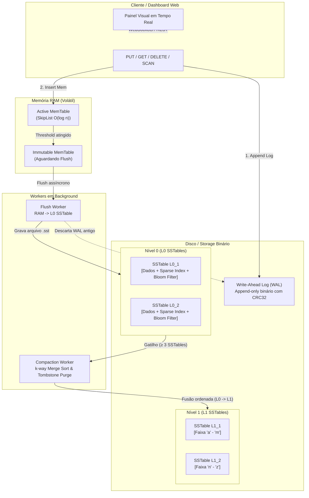

# Aether Storage Internals 📦

> **Mini LSM-Tree Key-Value Storage Engine & Telemetry Inspector**  
> Implementação artesanal de uma *Storage Engine* baseada em **LSM-Tree** (*Log-Structured Merge-tree*), no estilo de motores industriais como **RocksDB**, **LevelDB** e **Cassandra**, desenvolvida do zero em Python com foco em observabilidade, I/O binário em disco e sistemas de arquivos de alta performance.

---

## 🏗️ Arquitetura do Sistema



---

## 🔬 Componentes Internos

### 1. Write-Ahead Log (`engine/wal.py`)
* **Append-Only:** Cada gravação (`PUT` ou `DELETE`) é imediatamente persistida no disco antes de ser confirmada.
* **Integridade com CRC32:** Cada registro carrega um checksum CRC32 sobre seus metadados e corpo.
* **Crash Resilience:** Em caso de queda brusca de energia durante uma escrita, o leitor do WAL detecta o registro truncado no final do arquivo, trunca os bytes inconsistentes e recupera com perfeição o estado consistente na MemTable.

### 2. MemTable & SkipList (`engine/skiplist.py` & `engine/memtable.py`)
* **SkipList Probabilística:** Altura dinâmica com probabilidade $p = 0.5$ e limite de 16 níveis, fornecendo $O(\log n)$ médio para busca, inserção e varredura ordenada sem o overhead de rotação de árvores AVL/Red-Black.
* **Contabilidade de Memória:** Rastreia bytes em tempo real (chave + valor + referências de ponteiros).
* **Buffer Ativo e Congelado (Frozen):** Ao atingir o limite configurado (default: 16 KB a 64 KB), a MemTable torna-se imutável e um novo WAL é rotacionado instantaneamente enquanto a anterior é persistida no disco.

### 3. SSTables no Disco (`engine/sstable.py` & `engine/bloom_filter.py`)
Cada arquivo `.sst` gerado possui layout binário composto por 4 blocos:
1. **Data Block:** Sequência ordenada de registros empacotados via `struct`.
2. **Sparse Index Block:** Amostragem de chaves e offsets a cada $N$ registros (default: a cada 16 itens), permitindo busca binária rápida sem carregar todo o arquivo na memória.
3. **Bloom Filter Block:** Vetor de bits probabilístico com dispersão por *double-hashing*. Se o filtro indicar ausência da chave, a leitura do disco é **100% evitada**.
4. **Footer Fixo (32 Bytes):**
   * Offset e tamanho do Índice Esparso (12 bytes)
   * Offset e tamanho do Filtro de Bloom (12 bytes)
   * Contagem de registros (4 bytes)
   * Magic Bytes de validação: `0x41455448` (`b"AETH"`)

### 4. Compactação em Background (`engine/compaction.py`)
* **k-way Merge Sort:** Mescla múltiplos arquivos com sobreposição de faixas de chaves usando ordenação lexicográfica.
* **Descarte de Versões Antigas:** Se uma chave possui múltiplas versões em arquivos diferentes, apenas a versão com maior timestamp é preservada.
* **Purga de Tombstones:** Quando registros de exclusão (lápides) são compactados para o nível mais baixo (onde nenhuma versão anterior pode existir abaixo), eles são completamente eliminados do disco, liberando espaço.

---

## 🚀 Como Executar

### 1. Inicializando o Servidor Central
A partir da raiz do repositório:

```bash
uv run python server.py
# OU
python server.py
```

Acesse no navegador:
* **Dashboard do Banco de Dados:** [http://localhost:8000/systems/aether_storage_internals/static/index.html](http://localhost:8000/systems/aether_storage_internals/static/index.html)
* **Documentação Swagger/OpenAPI:** [http://localhost:8000/docs](http://localhost:8000/docs)

---

## 📡 Endpoints da API

| Método | Rota | Descrição |
|---|---|---|
| `GET` | `/api/storage/state` | Retorna o snapshot completo da MemTable, SkipList, WAL e SSTables. |
| `POST` | `/api/storage/kv` | Grava uma chave e valor (`PUT`). |
| `GET` | `/api/storage/kv/{key}` | Busca pontual pelo valor da chave (`GET`). |
| `DELETE` | `/api/storage/kv/{key}` | Grava uma lápide de exclusão (`DELETE`). |
| `GET` | `/api/storage/scan` | Varredura de intervalo ordenado (`SCAN`). |
| `GET` | `/api/storage/trace/{key}` | Consulta com auditoria visual passo a passo de todas as camadas. |
| `GET` | `/api/storage/raw-block/{filename}` | Inspetor hexadecimal e mapeamento de blocos em disco. |
| `POST` | `/api/storage/actions/flush` | Força o flush da MemTable ativa para uma nova SSTable L0. |
| `POST` | `/api/storage/actions/compact` | Força ciclo manual de compactação L0 ➜ L1. |
| `POST` | `/api/storage/actions/crash` | Simula queda abrupta de energia (esvazia RAM sem flush). |
| `POST` | `/api/storage/actions/recover` | Executa o replay do WAL para restaurar a consistência. |
| `POST` | `/api/storage/bench` | Executa benchmark automatizado (Sequential, Random, Churn). |
| `WS` | `/ws/storage` | Canal WebSocket para telemetria e animação em tempo real. |

---

## 🧪 Testes Automatizados

Para rodar todos os testes unitários e de integração do motor:

```bash
python -m unittest discover systems/aether_storage_internals/tests/
```
